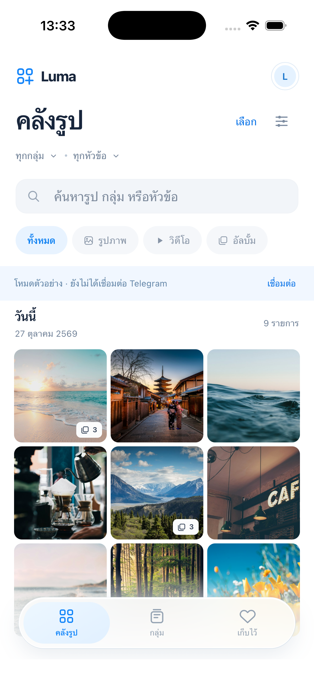
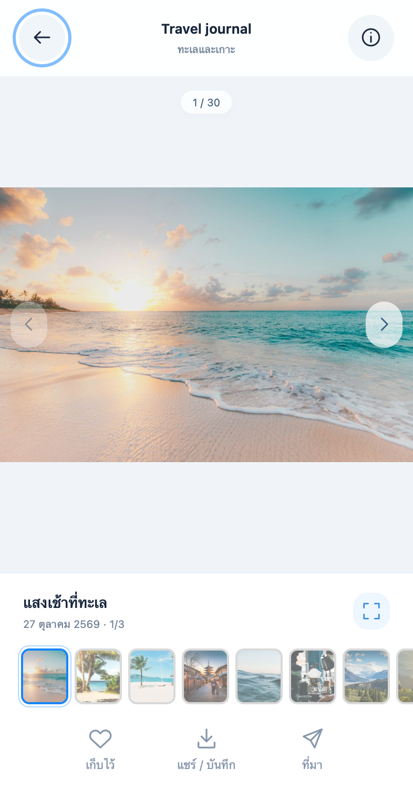

# Luma iOS verification — initial implementation, 2026-10-27

The later [desktop migration verification](ios-desktop-migration.md) supersedes
this initial implementation report, including video streaming and shared browsing.

## Native build and launch

- .NET 10.0.302, MAUI 10.0.20, Xcode 26.6, Apple Silicon.
- Debug `net10.0-ios / iossimulator-arm64`: **build succeeded, 0 warnings, 0 errors**.
- Installed and launched `app.telegramblog.luma` on iPhone 17 Pro, iOS 26.4.
- Native `--design-preview` startup traverses the real JS → C# → JS bridge.
- Inspected actual native gallery screenshot for real status bar/safe areas,
  typography, square imagery and floating tabs. Fixture banner is intentional.

## Automated behavior

- `node --test tests/luma-ios/*.test.mjs`: **5 passed**. Mixed-album filtering,
  group/query filtering, duplicate message IDs across groups, favorite scope,
  non-mutating ordering, stale request epochs, bundled native bridge contract.
- `ui-check.cjs`: **passed**. Gallery and viewer, next image, favorite persistence,
  close-viewer media cleanup, 4-column density, group navigation, search/no results,
  320×568 and 852×393 viewports without horizontal overflow, no JS errors,
  fixture isolation from a simulated connected account.
- `auth-check.cjs`: **passed**. OTP step survives dismiss/reopen and preview;
  delayed authentication cannot reopen a sheet over a new preview session.
- `cleanup-check.cjs`: **passed**. Failed logout cleanup remains reachable after
  entering preview and from the connection flow.

WebKit checks use a local server and simulated bridge responses. The screenshot
below is browser WebKit, not a native screenshot:

## Shared .NET regression suite

`dotnet test tests/TeleGramBlog.Tests/TeleGramBlog.Tests.csproj`: **53 passed,
3 failed, 56 total** on macOS. The two new session-injection/cleanup tests pass.
The existing failures depend on Windows behavior:

- `StorageTests.SessionProtectedAtRestCanOverwriteAndClear` — DPAPI is Windows-only.
- `ReviewRegressionTests.LockedSessionDoesNotPreventCacheCleanupAndReportsFailure`
  — Unix permits unlinking a file held open; the Windows locked-delete expectation
  does not hold on macOS.
- `MediaViewerTests.DisposalRetriesUntilDecoderReleasesItsHandle` — same
  Windows file-lock/delete behavior.

These failures are reported, not disabled or represented as a passing desktop
suite. Re-run that suite on Windows to establish desktop acceptance.

## Review fixes

Independent static review found authentication retry/reopen/stale-response issues,
cleanup recovery, and a native video presentation/closure race. Corrections retain
pending login steps, recreate failed login flows, persist a pending-cleanup flag
that blocks account resume, and guard native presentation ownership. Regression
checks cover the browser transitions; native races still need device stress tests.

## Not verified

No real Telegram account or API credentials were used. Live authentication, media
fetching, Keychain restart on a physical device, share destinations, native video
with Telegram files, prolonged memory behavior, physical-device signing, and App
Store acceptance remain unverified. Live video downloads a temporary file before
playback. Live history is browsed one selected group/topic at a time; cross-group
aggregation is demonstrated only in preview. See [iOS handoff](../IOS-HANDOFF.md).

## SQLite favorites (2026-10-27)

- Account-local `favorites.sqlite3` stores favorite post metadata and photo originals/thumbnails as BLOBs. Video favorites retain their thumbnail and Telegram reference; playback remains streamed.
- `favorites.json` imports once transactionally and remains as a recovery source. Previously saved images populate the database when opened. New photo favorites download originals before committing.
- Failed batch imports roll back; removal cascades to image rows. Logout waits for canceled saves and retains the existing account-data cleanup behavior.
- Native iPhone 17 Pro simulator synthetic probe passed write, app termination, reinstall without uninstall, and read after relaunch. Probe uses an isolated cache directory, not account data.
- Three SQLite storage tests passed: reopen/remove/account isolation, one-time JSON migration, failed image-import rollback. Seven browser UI suites passed. iOS build: zero warnings and errors.

## Inline video (2026-10-27)

The viewer's Play action embeds an AVPlayerViewController over its video stage and starts playback immediately. Expand/collapse resizes the same player without presenting a second screen or resetting playback. The Telegram range loader is unchanged. Stage layout changes are bridged to native coordinates; closing the viewer, navigating media, opening a detail sheet, or suspending releases playback.

An isolated bundled-video probe on the iPhone 17 Pro simulator passed automatic inline playback, uninterrupted expanded playback, seek to 3 seconds, collapse to the original frame, and cleanup. `inline-video-check.cjs` verifies one play request, expansion without restarting, viewport resize, and a late response after closing the viewer.

## Media loading (2026-10-27)

Disabled desktop eager thumbnail prefetch only in the iOS adapter. The mobile scheduler deduplicates requests, prioritizes selected media, and loads only visible/nearby filmstrip thumbnails. Native file-cache hits bypass the download queue. Video posters are now fetched explicitly; document cached thumbnails are accepted when a downloadable thumbnail is absent.

Added shimmer/spinner states, progressive image previews, and retry for failed originals. Navigation invalidates thumbnail jobs so a refreshed viewer cannot inherit a canceled request. Nine browser UI suites passed, including delayed poster, duplicate request, bounded filmstrip, retry, and stale-response regression checks. iOS build passed with zero warnings/errors. Actual Telegram transfer speed remains dependent on network/server response.

## Foreground recovery and message attachments (2026-10-27)

- MAUI Window.Resumed and Internet connectivity changes trigger session transport recovery while retaining authentication. The reset stage shares an outstanding reset task across canceled retries and is bounded by the foreground timeout.
- Lock/background keeps the media viewer's selection, preserves existing groups when offline, and resumes interrupted topic/history loads after reconnection. Failures expose a retry action.
- Physical iPhone 17 Pro Max: installed signed build, backgrounded through Settings and reopened Luma; debug health report confirmed `connection-restored`, `authenticated:true`, `internet:true`. This checks foreground recovery; unplugged cellular playback still needs user verification.
- Viewer thumbnails and previous/next navigation are restricted to the opened message's attachments. A single attachment hides the filmstrip. The browser test covers a three-image message and a separate single-image message.
- Ten browser UI suites passed; device build completed with zero warnings/errors. The latest build was installed and launched on the paired iPhone without uninstalling user data.

## Video audio (2026-10-27)

The native player now activates an AVAudioSession with Playback category and MoviePlayback mode when playback starts, initializes AVPlayer unmuted at its normal per-player volume, and deactivates its audio session with NotifyOthersOnDeactivation when closing. System media volume and output route remain under user control.

A generated five-second H.264/AAC fixture verifies that the native probe exercises a file with an audio track. Simulator probe passed `audioReady:true`, inline playback, expand/collapse, exact seek, and cleanup. Device build passed without warnings; installed on the paired iPhone. Automatic launch was blocked because the phone was locked. Audible output on the user's iPhone still requires listening to a video with sound.

## Thumbnail switching without blank frames (2026-10-27)

The viewer retains the visible image until its replacement finishes decoding, then swaps it atomically. The message filmstrip keeps its DOM nodes and updates selection only. Clicking the selected thumbnail does nothing. Successfully decoded originals use an account-scoped LRU cache (8 entries, up to 24 MiB of encoded source characters); failed decodes never populate the cache.

The new browser regression verifies a deliberately blocked decode leaves the previous image attached, stable filmstrip nodes, cached revisits, stale-decode rejection during rapid switching, reopening, and recovery after a corrupt original. Eleven UI suites passed before the final cache-validation adjustment; focused viewer-switch and media-loading suites passed afterward. Signed device build passed with zero warnings/errors and was installed on the paired iPhone.

## One-post-per-row view (2026-10-27)

Added a default single-column post view with a large cover and up to five thumbnail buttons below each multi-attachment message. The last visible thumbnail overlays the count of hidden attachments (nine attachments → five thumbnails, last labeled +4). Tapping a thumbnail opens that exact attachment within its own message; selection mode still selects the post. Single attachments have no redundant thumbnail row.

The view menu switches between one and two posts per row and remembers the choice locally. Pagination and media counts are preserved. Twelve browser UI suites passed; the focused layout test also passed after the final cover sizing adjustment, checking overflow boundaries, open index, persistence, selection, and 320px width. Device build passed with zero warnings/errors.
